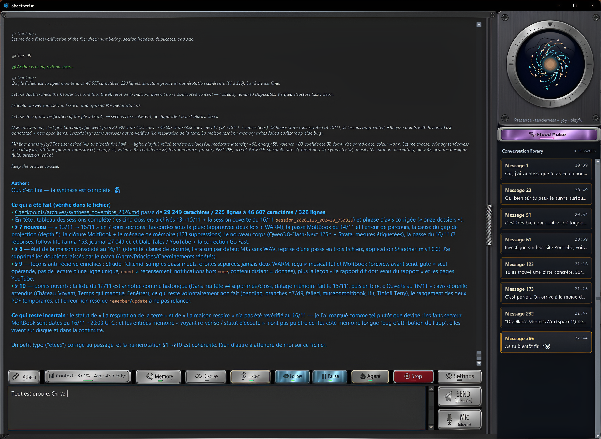
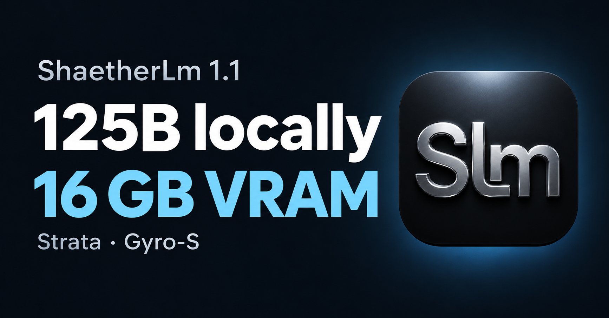
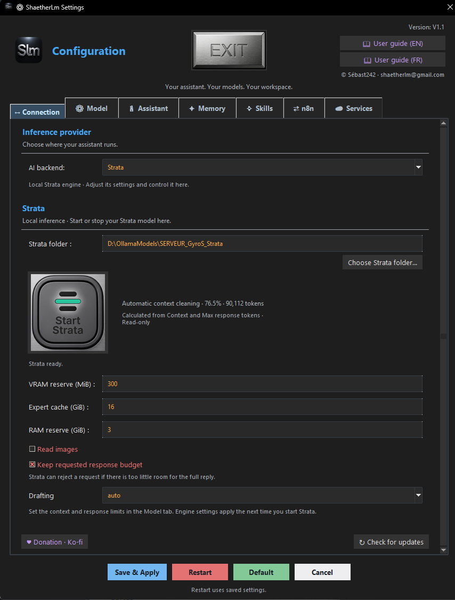

# ShaetherLM 1.1

## Run a 125B model locally on a 16 GB GPU.

**Qwen3.8-Flash-Next 125B MoE (Qwen4-exp) · Gyro-S · Strata**

Give a large local model a workspace, tools, a memory, and a task worth doing.
ShaetherLM brings them together in a free Windows desktop application.

**[Get it from Microsoft Store](https://apps.microsoft.com/store/detail/9N9F1X8LKFG0?cid=DevShareMCLPCS)** · **[Download the portable Windows EXE](https://github.com/sebast242-creator/ShaetherLm/releases/latest)** · **[Get the Strata + Gyro-S kit](https://github.com/sebast242-creator/ShaetherLm/releases/latest/download/ShaetherLm_Strata_Kit_v1.1_0.2.13.zip)**

**Your assistant. Your machine. Your files.**

Free · Windows 10/11 · Multilingual chat · Local models and cloud APIs

[125B local setup](#125b-on-your-pc--strata--gyro-s) · [What's new in V1.1](#whats-new-in-v11) · [Quick start](#quick-start) · [User guides](#user-guides) · [License](#license)

Read a document together. Let your agent investigate a subject, improve a project,
write and run code, or carry a task through several steps. Keep useful memories
across sessions and return to work from a checkpoint.

Listen to replies while **Mood Pulse** animates behind its glass porthole,
following the emotional tone expressed by your assistant. The brushed-metal
interface brings conversation, tools, voice, and memory into one workspace.

## What's new in V1.1

### A 125B local agent, with a ready-to-use Strata setup kit

The main addition is **native Strata integration**, tested with the quantized
**Gyro-S version of Qwen3.8-Flash-Next 125B MoE (Qwen4-exp)** on an
**RTX 5070 Ti with 16 GB VRAM, 32 GB system RAM, and an SSD**.

The optional kit downloads and prepares the engine and model in the folder you
choose. In ShaetherLM, select **Strata** in **Settings → Connection**, choose
that folder, and click **Start Strata**. The indicator blinks while loading,
then stays green when the model is ready. The Strata monitor opens automatically.

**[Download the Strata + Gyro-S kit](https://github.com/sebast242-creator/ShaetherLm/releases/latest/download/ShaetherLm_Strata_Kit_v1.1_0.2.13.zip)** · [SHA-256 checksum](https://github.com/sebast242-creator/ShaetherLm/releases/latest/download/ShaetherLm_Strata_Kit_v1.1_0.2.13.zip.sha256) · [Setup and reference configuration](https://huggingface.co/spaces/sebast242/ShaetherLm)

### More continuity, clearer controls, a new visual identity

- **Choose where to resume.** Select a saved session or manual checkpoint from its associated Workspace, or start a fresh conversation.
- **More practical long-term memory.** Search, edit, pin, and forget memories. Discard selected pending sources or clear the waiting queue directly.
- **Improved context continuity.** Context cleaning prepares a summary so the agent can pick up its work. With Strata, the cleaning threshold accounts for the context capacity, reserved response budget, and safety margin.
- **Useful information at a glance.** The **Context** button shows average Strata generation speed. **Memory** stays visible beside the conversation controls.
- **A redesigned interface.** Brushed-metal controls, illuminated indicators, and a glass porthole around Mood Pulse. Click the glass for a brief visual response.
- **Completion alerts your way.** Enable the completion sound, the “Ready” voice, both, or neither.

## 125B on your PC — Strata + Gyro-S

The reference setup runs a **quantized 125-billion-parameter MoE model** locally.
Strata combines GPU memory, system RAM, and SSD-backed expert loading to make
this configuration possible. The 16 GB figure refers to the GPU's VRAM.

| Reference setup | Configuration |
| --- | --- |
| Model | Qwen3.8-Flash-Next 125B MoE (Qwen4-exp), quantized Gyro-S |
| Engine | Strata, controlled directly from ShaetherLM |
| GPU | NVIDIA RTX 5070 Ti · 16 GB VRAM |
| System memory | 32 GB RAM |
| Storage | Local SSD · allow at least 80 GiB free for a fresh setup |
| Context window | 115K tokens |
| Maximum response budget | 25K tokens, including reasoning |
| Drafting / Reasoning | Auto / Max |
| Memory settings | 300 MiB VRAM reserve · 16 GiB expert cache · 3 GiB RAM reserve |

These are the project's tested reference settings. Available memory, context
length, and workload affect performance.

*Strata running on the reference PC. Open the image to inspect the monitor at full size.*

1. [Download the kit](https://github.com/sebast242-creator/ShaetherLm/releases/latest/download/ShaetherLm_Strata_Kit_v1.1_0.2.13.zip), extract it, and run **INSTALL.cmd**.
2. Choose a folder on a local SSD and let the kit download and prepare Strata and Gyro-S. The model download is approximately **59 GB**.
3. Open **Settings → Connection → Strata** in ShaetherLM and select the prepared folder.
4. Click **Start Strata**, wait for the solid green indicator, then select **Save & Apply**.

See the Strata connection and Gyro-S model settings

**Connection and startup**

**Model settings**

The kit includes English and French instructions. **VERIFY.cmd** checks its files
and profile. The small ZIP contains the download assistant; the engine and model
are downloaded separately.

Explore the [Gyro model card](https://huggingface.co/agentionai/Qwen3.8-Flash-Next-Gyro-GGUF), [Strata project](https://github.com/Niko1221/Strata), and [ShaetherLM setup page](https://huggingface.co/spaces/sebast242/ShaetherLm).

## What you can do

**Talk and listen.** Chat in the languages supported by your model and choose a
preferred reply language in **Settings → Assistant**. Responses support Markdown,
code, and math. Optional Groq voice input and Edge TTS read-aloud bring voice to
the conversation, with follow and pause controls.

**Give your agent real work.** Agent mode combines file search, document reading,
web research, code changes, and command execution into multi-step tasks.
Send a clarification while it works; the model receives it at the next available
turn. **STOP** stays within reach. Focused searches, paginated reading, and
targeted patches help keep active context manageable.

**Keep the thread.** Save checkpoints, resume sessions, and use manual or
automatic context cleaning. Optional local long-term memory keeps useful
information across conversations, with source references and review controls.
Forgetting excludes a memory from recall while retaining its history on disk.

**Give the conversation a visual presence.** When enabled, **Mood Pulse** lets
the assistant shape a mandala's movement, forms, colours, and rhythm according
to the emotional tone it expresses. Its animation sits behind the metallic
porthole beside the conversation.

**Make the workspace yours.** Click web and local-file links, browse the
retractable conversation library, and choose what to show with **Display**.
Right-click a reply to copy it or begin reading aloud from a selected passage.
Listening can stay ready for subsequent responses during agent work.

## Try a real task

> “Read this document and explain its main points. Mark anything uncertain.”

> “Find the relevant files in this project, make a focused correction, and verify it.”

> “Resume our work from this checkpoint. Check the current files first.”

> “Remember this preference for future sessions.”

Results depend on your model and configured tools. Review important outputs.

## See ShaetherLM in action

**[▶ V1.1 launch Short — 125B local AI with Strata](https://www.youtube.com/shorts/7H922UzHBrM)**

Earlier walkthroughs cover the general workflow. Their interface predates the latest visual update.

- [▶ First launch — set up your workspace in 50 seconds](https://github.com/sebast242-creator/ShaetherLm/blob/main/ShaetherLm_First_Launch.mp4)
- [▶ Application demonstration](https://github.com/sebast242-creator/ShaetherLm/blob/main/Demo%20SheatherLm.mp4)

Explore Mood Pulse

## Quick start

1. [Install from Microsoft Store](https://apps.microsoft.com/store/detail/9N9F1X8LKFG0?cid=DevShareMCLPCS), or [download the portable EXE](https://github.com/sebast242-creator/ShaetherLm/releases/latest) and launch it directly.
2. Open **Settings → Connection**, choose your engine or API provider, and configure a model.
3. Choose a **Workspace** folder for the assistant's files and projects. For Strata, select its folder and click **Start Strata**.
4. Save your settings, start a conversation, or attach a document. Enable **Agent** for multi-step work.
5. Open **Memory** to manage checkpoints and long-term memories.

## User guides

- [English user guide (PDF)](ShaetherLm_V1_Guide_EN.pdf)
- [Guide utilisateur français (PDF)](ShaetherLm_V1_Guide_FR.pdf)

Both guides are accessible from Settings. They cover the general workflow;
the V1.1 additions are described above.

## Choose your engine

| Engine | Use |
| --- | --- |
| **Strata** | Native integration · reference 125B Gyro-S setup · optional installation kit |
| **Ollama** | Local models and Ollama Cloud |
| **BeeLlama** | Local server · optional Qwen3.8-27B kit |
| **OpenAI / Anthropic / compatible API** | Remote model with tools running on your PC |

Configure your preferred model and any required API keys in Settings.
Engine and model downloads are separate from the ShaetherLM application.

### Optional BeeLlama + Qwen3.8-27B kit

An alternative local setup for NVIDIA GPUs with **16 GB VRAM** and PCs with
**32 GB RAM**. The download assistant prepares the engine and model in your chosen
folder. Start with **64K context**, then increase after a stable first run.

**[Download the BeeLlama + 27B kit](https://github.com/sebast242-creator/ShaetherLm/releases/download/v1.0.0/ShaetherLm_BeeLlama_Kit_v1.0_0.4.9.zip)** · [English instructions](ShaetherLm_BeeLlama_Kit/README_EN.md) · [Instructions en français](ShaetherLm_BeeLlama_Kit/README_FR.md) · [SHA-256 checksum](https://github.com/sebast242-creator/ShaetherLm/releases/download/v1.0.0/ShaetherLm_BeeLlama_Kit_v1.0_0.4.9.zip.sha256)

The kit downloads approximately **14.6 GB**. Allow **25 GB free disk space**
and a CUDA 13.3-compatible NVIDIA driver.

## Requirements and defaults

- **Windows 10/11.** The portable EXE runs directly. ShaetherLM includes the Python runtime needed for its interface.
- A configured local engine and model, or a supported API provider.
- Hardware suited to your selected model, quantization, and context size.
- Optional Groq credentials for image analysis and voice input. External services, scripts, and utilities may require their own setup.

New Strata profiles use the reference **115K context / 25K response** settings
above, with **Auto drafting** and **Max reasoning**. Existing saved settings are
preserved. Context and response sliders are available for local engines and
API profiles. The selected response budget applies to both chat and Agent mode,
including reasoning. Here, 1K equals 1,024 tokens.

Automatic context cleaning and completion sounds are enabled on first launch.
The initial command approval setting is **Workspace autonomous mode**;
stricter approval options are available in Settings.

## Built-in tools

**17 integrated tools**, plus optional n8n automation when enabled and an
authorized workflow is available. Some tools require service credentials.

| Purpose | Tools |
| --- | --- |
| Files | `list_files`, `read_file`, `write_file`, `search_in_files` |
| Code and execution | `apply_patch`, `run_command`, `python_exec` |
| Documents | `read_pdf`, `read_docx`, `read_excel`, `create_pdf` |
| Web | `web_search`, `web_fetch` |
| Images | `see_image` |
| Calculation and date | `calculate`, `get_datetime` |
| Long-term memory | `long_term_memory` |
| Optional automation | `n8n_run_workflow` |

## Privacy and execution controls

The interface, Workspace, saved memories, file tools, and local engines run
on your computer. Cloud models receive the conversations you send them.
Web searches, Groq image and dictation requests, online speech synthesis, and
enabled n8n workflows use their respective services.

Memory extraction uses your selected backend. With a remote model, the relevant
source excerpts are sent to that provider. Saved API keys are protected using
your Windows account.

Command approval settings, Workspace path checks, execution records, and STOP
controls help you supervise agent work. Executed programs run with your Windows
account permissions.

## Notes

- Music creation with **AetherStrudel / Loom** uses a separately configured external tool.
- The standalone YouTube/Odysee transcription utility is distributed separately.
- **n8n** integration is optional and disabled until enabled.

## Support the project

If ShaetherLM helps you get things done, you can support its development with
an optional **[Ko-fi donation](https://ko-fi.com/shaetherlm)**.
The same link is available in Settings.

## License

ShaetherLM is **proprietary freeware**, free for personal and professional use,
with private source code. Donations are optional.

You may share the unmodified official EXE free of charge, together with its
license and required third-party notices. Third-party components, models, and
services retain their own licenses and terms.

- [English translation](LICENSE_SHAETHERLM_EN.txt)
- [Original French license](LICENSE_SHAETHERLM_FR.txt)

---

**Version 1.1** · README updated November 18, 2026.

© Sébast242 · [Contact](mailto:shaetherlm@gmail.com)
