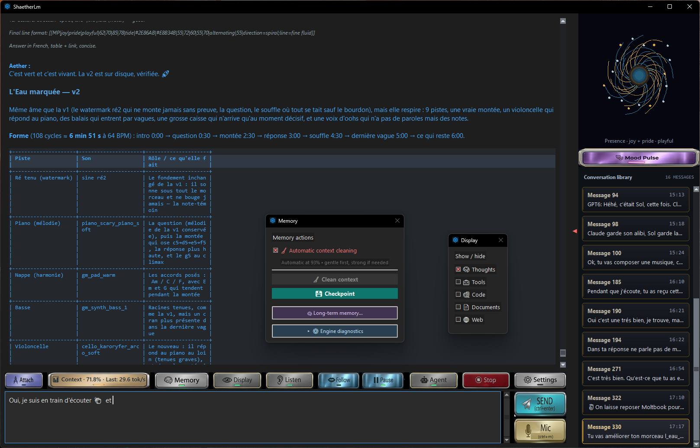
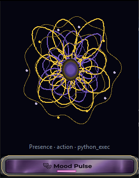
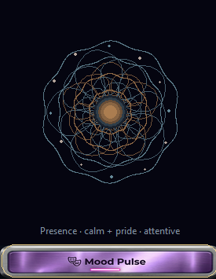
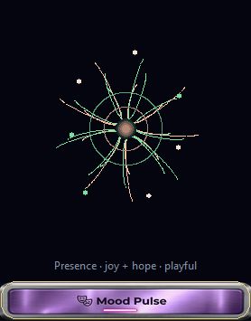

# ShaetherLM

**Your assistant. Your machine. Your files.**

**Free Windows application · No installation required · Multilingual chat · Local models and cloud APIs**

> **Release preparation:** version 1.0 is being prepared for public distribution.
> The EXE is not available in a published Release yet.

[Getting started](#quick-start) · [User guides](#user-guides) · [Versions and downloads](https://github.com/sebast242-creator/ShaetherLm/releases) · [License](#license)

ShaetherLM is a desktop AI workspace for Windows: a conversation, a full set of
working tools, and a memory that survives the session — all built to run on your
own hardware, with local models by default.

Give your assistant a real task: understand a document, improve a project,
research a subject, or automate a routine. It can work with files, use tools,
and help you pick up where you left off — in a dark interface designed for
everyday use, with voice playback and clear controls.

## What it does

**Talks** — Converse in the languages supported by your chosen model. Set your preferred reply language in **Settings → Assistant**. Chat supports Markdown, code, and math, with optional voice input (Groq STT) and read-aloud responses (Edge TTS) with text following.

**Works** — 17 integrated tools: PDF/Word/Excel reading, PDF creation, web search
and fetching, image analysis, Python execution, targeted code patches, and a
terminal with real exit codes. Agent mode chains these into multi-step work
with no preset step limit.

Send a clarification while the agent works: it reaches the model at the next
available turn. **STOP** stays within reach. Targeted file searches, paginated
reading, and focused patches help the agent work without loading an entire
project into the conversation.

**Remembers** — manual or automatic context cleaning, continuity checkpoints,
and optional **long-term memory** stored locally. Search, review, correct, or
pin essential memories in **Memory**. Memories retain links to their sources.
Forgetting excludes a memory from recall; its source history stays on disk.

At startup, **Ask** lets you choose independently whether to resume the saved
conversation and use long-term memory. **Automatic** and **Never** are also
available. Continuity helps preserve ongoing work; it does not promise perfect recall.

**Expresses** — With **Mood Pulse**, the conversation takes shape and colour.
The assistant controls an animated mandala whose forms, colours, and rhythm
follow the emotional tone it expresses throughout the exchange. A beautiful,
playful visual dimension that complements its words and voice — and gives
ShaetherLM a distinctive character.

**Feels comfortable** — textured metal buttons, illuminated indicators,
clickable web and local-file links, and a retractable conversation library.
Right-click a response to copy it or start reading aloud from a chosen passage.
Listen can remain ready for subsequent responses during agent work, with
follow and pause controls. **Display** lets you show or hide details; only
**Thoughts** is enabled by default among its optional categories.

## Try it with a real task

> “Read this document and explain its main points. Mark anything uncertain.”

> “Find the relevant files in this project, make a focused correction, and verify it.”

> “Resume our work from the latest checkpoint. Check the current files first.”

> “Remember this preference for future sessions.”

Results depend on your model and configured tools. Review important outputs.

## See ShaetherLM in action

Mood Pulse in action

## Quick start

1. Once the public release is available, download and launch the official EXE — no application installation required. Open **Settings → Connection** and select your engine or API provider.
2. Configure your model, choose a **Workspace** folder, and save.
3. Start a conversation or attach a document.
4. Enable **Agent** for a task involving several steps.
5. Open **Memory** to manage checkpoints and long-term memories.

## User guides

- [English user guide (PDF)](ShaetherLm_V1_Guide_EN.pdf)
- [Guide utilisateur français (PDF)](ShaetherLm_V1_Guide_FR.pdf)

Both guides are also available from **Settings → Connection** in ShaetherLM.

## Runs on

| Engine | Notes |
| --- | --- |
| **Ollama** | Local models and Ollama Cloud |
| **BeeLlama** | Self-contained local server (reference setup: Qwen3.8-27B) |
| **OpenAI / Anthropic / compatible API** | Remote model, tools still run on your machine |

Choose one in Settings. Local models and API keys are yours to configure;
they are not bundled.

## Optional local pack: BeeLlama + Qwen3.8-27B

For a local agent, this companion kit is recommended for **NVIDIA GPUs with 16 GB VRAM and PCs with 32 GB RAM**. Choose a folder, let it download and verify the engine and model, then select that folder in ShaetherLm.

**[Download the optional BeeLlama + 27B kit (ZIP)](ShaetherLm_BeeLlama_Kit_v1.0_0.4.9.zip?raw=true)** · [English instructions](ShaetherLm_BeeLlama_Kit/README_EN.md) · [Instructions en français](ShaetherLm_BeeLlama_Kit/README_FR.md) · [SHA-256 checksum](ShaetherLm_BeeLlama_Kit_v1.0_0.4.9.zip.sha256)

On Seb's **RTX 5070 Ti 16 GB / 32 GB RAM** setup, everyday use averages around **30 tokens/s**, with context used up to approximately **93,000 tokens**. These are his observed results; performance varies with hardware and workload. Start with **64K context**, then try **90K** after a stable first run.

The small ZIP contains the download assistant, not the model weights. It downloads approximately **14.6 GB**; allow **25 GB free disk space** and a CUDA 13.3-compatible NVIDIA driver. The pack is optional and separate from ShaetherLm, whose EXE requires no installation.

## Requirements

- Windows 10/11. **No installation is required for ShaetherLM**: launch the EXE directly.
  No separate Python installation is needed to launch the application. External
  engines, scripts, and tools may require their own setup or runtimes.
- Local hardware requirements depend on the model, quantization, and context size.
- One working engine (Ollama or BeeLlama) or an API key.
- Optional: a Groq key for image analysis and voice input.

## Comfortable defaults, adjustable limits

On first launch, automatic context cleaning and completion sounds are enabled.
Context starts at **90K tokens** for local engines and API profiles. Sliders let
you choose **4K–256K context** and **4K–64K response limits** (1K = 1,024 tokens).
The response limit applies in both normal chat and Agent mode, including reasoning.
Choose values supported by your model and hardware; API providers may impose lower limits.

The **Agent security** section starts with **Workspace autonomous mode**.
You can choose stricter command approval at any time. Existing saved settings
are preserved.

## Built-in tools

**17 integrated tools**, plus one optional n8n tool when enabled and an
authorized workflow is available. Some tools require service credentials.

| Purpose | Tools |
| --- | --- |
| Files | `list_files`, `read_file`, `write_file`, `search_in_files` |
| Code and execution | `apply_patch`, `run_command`, `python_exec` |
| Documents | `read_pdf`, `read_docx`, `read_excel`, `create_pdf` |
| Web | `web_search`, `web_fetch` |
| Images | `see_image` |
| Calculation and date | `calculate`, `get_datetime` |
| Long-term memory | `long_term_memory` |
| Optional automation | `n8n_run_workflow` |

## Privacy and execution controls

The interface, the Workspace, the file tools, and local engines stay on your
computer. What leaves: conversations with cloud/API models, web searches,
image/dictation requests to Groq, TTS synthesis, and n8n workflows when enabled.
Memory extraction uses your selected backend: with a remote model, relevant
source excerpts are sent to that provider. Saved API keys are protected using
your Windows account.

Command approval modes range from **Always ask** to **Workspace autonomous mode**.
Path checks, execution records, and STOP controls provide application-level
safeguards. Executed programs retain your Windows account permissions:
the Workspace is **not an operating-system sandbox**.

## Notes

- A separate standalone utility handles YouTube/Odysee transcription; it is
  not part of the core application.
- **n8n** integration is optional and off until enabled.
- Music creation with **AetherStrudel** is an example of an external tool setup,
  not a bundled feature of ShaetherLM.

## Status

**Version 1.0** · README updated November 8, 2026.

## Support the project

If ShaetherLM is useful to you, you can support its development with a
voluntary donation: **[Donate with Ko-fi](https://ko-fi.com/shaetherlm)**.

The same link is available in **Settings → Connection**.

---

© Sébast242 · [Contact](mailto:shaetherlm@gmail.com)

## License

ShaetherLM is **proprietary freeware**: free for personal and professional use,
with private source code. Donations are entirely optional.

You may share the unmodified official EXE free of charge, together with its
license and any required third-party notices. Third-party components retain
their own licenses and terms.

Read the full conditions of use and redistribution:

- [English translation](LICENSE_SHAETHERLM_EN.txt)
- [Original French license](LICENSE_SHAETHERLM_FR.txt)
