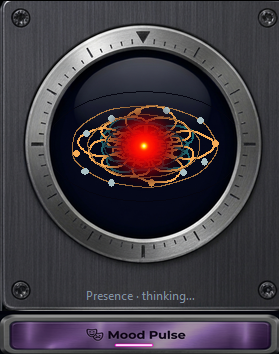

# ShaetherLM 1.2

ShaetherLM is a free Windows workspace for multilingual chat, voice, documents,
and multi-step work with an agent. Save checkpoints to resume a project and
use long-term memory across sessions. Run a local model with Ollama, BeeLlama,
or Strata, or connect to Ollama Cloud, OpenAI, Anthropic, or a compatible API.

**Version 1.2** adds Strata diagnostics, refines session selection at startup,
and updates the French and English guides. The optional Strata kit lets you run
the **Gyro-S quantization of Qwen3.8-Flash-Next 125B MoE (Qwen4-exp)** locally.

## What’s new in 1.2

- **Strata defaults.** New profiles use **120K context (122,880 tokens)**,
  a **19K response budget (19,456 tokens)** including reasoning, **Auto drafting**,
  and **Max reasoning**. Saved profiles keep their settings. At these defaults,
  the automatic context cleaning threshold is **101,376 tokens (82.5%)**,
  including a 2,048-token safety margin in the calculation.
- **Engine diagnostics.** In **Memory → Engine diagnostics**, Strata shows the
  engine version, the speed of the latest generation, the average since engine
  startup, and the context capacities reported by ShaetherLM and Strata.
- **Session selection at startup.** In **Memory at startup**, choose a continuity
  save or a manual checkpoint from the active Workspace, or start a fresh chat.
  **Resume selected session** is blue, **Continue** is green, and **Settings**
  is red. Long-term memory can be enabled independently.
- **Updated guides.** The illustrated V1.2 guides cover the 125B Strata setup,
  session recovery, engine diagnostics, and the HAL mode in Mood Pulse.
  Both guides open from **Settings**.
- **Updated Windows kit.** The optional Gyro-S kit uses **Strata 0.2.20**
  with engine **0.1.66**. Its profile includes Strata’s recommended workaround
  for a startup crash affecting some NVIDIA configurations.
  [Strata issue](https://github.com/Niko1221/Strata/issues/6790)

## What’s new in 1.1

### Native Strata integration

- **Start your local model from Settings.** In **Settings → Connection**,
  select **Strata**, choose its folder, and click **Start Strata**. The green
  indicator blinks during loading and stays lit when the model is ready.
  The Strata monitor opens automatically.
- **See generation speed at a glance.** The **Context** button shows average
  Strata generation speed in tokens per second.
- **Clearer context recovery.** Cleanup accounts for context capacity, the
  reserved response budget, and a safety margin. ShaetherLM indicates whether
  cleanup followed your chosen threshold or a request exceeding the available
  context. Strata prepares continuity summaries with reasoning disabled.

### Easier memory and session continuity

- **Memory stays within reach.** The **Memory** control remains visible
  beside the conversation controls. Search, edit, pin, and forget long-term
  memories directly.
- **Manage pending sources.** In **Memory → Long-term memory → Pending sources**,
  discard selected blocks or clear the queue, even when the engine is stopped.
  Memory extraction uses Strata when it is the selected backend.

### Brushed metal, glass, and HAL

- **A refreshed visual identity.** Brushed-metal controls, illuminated
  indicators, and a glass porthole frame the conversation and Mood Pulse.
- **A new HAL-inspired core.** Keep the original animated mandala or add a
  luminous yellow centre with a soft red glow. Its movement responds to the
  existing mood and activity signals.
- **A click to switch.** Enable **Mood Pulse** and click inside the glass
  while the assistant is idle. Click again to return to the original look.
  Switching is unavailable during generation, tool use, context cleanup,
  image analysis, or memory work.
- **Two alternating voice clips.** Entering HAL alternates between *“I feel
  much better now”* and *“I want to help you.”* Returning to the original mode
  is silent. The visual choice lasts for the current app session.
- **Completion alerts your way.** Enable the completion sound, the “Ready”
  voice, both, or neither.

  

HAL is a visual variation of Mood Pulse: it changes the presentation, not the
model, its instructions, or its personality.

## Getting started

Download `ShaetherLm.exe` from **Assets** below and launch it on Windows 10 or 11.
Open **Settings → Connection**, select your engine or API provider, and choose
a **Workspace** folder. The portable application runs directly from the EXE;
local engines and models have their own setup.

## Optional local AI kits

### Strata + Gyro-S 125B

Download the [Strata 0.2.20 + Gyro-S kit](https://github.com/sebast242-creator/ShaetherLm/releases/download/v1.0.0/ShaetherLm_Strata_Kit_v1.2_0.2.20.zip),
extract it, and run **INSTALL.cmd**. Choose a folder on a local SSD, then select
that folder in ShaetherLM and click **Start Strata**.
[SHA-256 checksum](https://github.com/sebast242-creator/ShaetherLm/releases/download/v1.0.0/ShaetherLm_Strata_Kit_v1.2_0.2.20.zip.sha256)

The reference setup uses an **RTX 5070 Ti with 16 GB VRAM**, **32 GB RAM**,
and at least **80 GiB of free SSD space**. Strata combines GPU memory, system
RAM, and SSD-backed expert loading; the entire model does not fit in VRAM.
The quantized model download is approximately **59 GB**.

The small ZIP is a download assistant. It fetches the engine and model
separately. English and French instructions are included, and **VERIFY.cmd**
checks the kit files and profile. Use the accompanying `.sha256` file to
verify the ZIP download.

### BeeLlama + Qwen3.8-27B

The alternative kit targets NVIDIA GPUs with **16 GB VRAM** and PCs with
**32 GB RAM**. Allow **25 GB of free disk space** and start with **64K context**.

[Download the BeeLlama kit](https://github.com/sebast242-creator/ShaetherLm/releases/download/v1.0.0/ShaetherLm_BeeLlama_Kit_v1.0_0.5.0.zip) · [SHA-256 checksum](https://github.com/sebast242-creator/ShaetherLm/releases/download/v1.0.0/ShaetherLm_BeeLlama_Kit_v1.0_0.5.0.zip.sha256)

## User guides

[English guide](https://github.com/sebast242-creator/ShaetherLm/blob/main/ShaetherLm_V1.2_Guide_EN.pdf) · [Guide français](https://github.com/sebast242-creator/ShaetherLm/blob/main/ShaetherLm_V1.2_Guide_FR.pdf) · [Full README](https://github.com/sebast242-creator/ShaetherLm#readme)

## Distribution

ShaetherLM is **proprietary freeware**, free for personal and professional use.
The unmodified official EXE may be redistributed free of charge under the
accompanying license. Third-party components retain their own licenses.

[English license](https://github.com/sebast242-creator/ShaetherLm/blob/main/LICENSE_SHAETHERLM_EN.txt) · [Licence française](https://github.com/sebast242-creator/ShaetherLm/blob/main/LICENSE_SHAETHERLM_FR.txt)

*Release notes updated November 24, 2026.*
